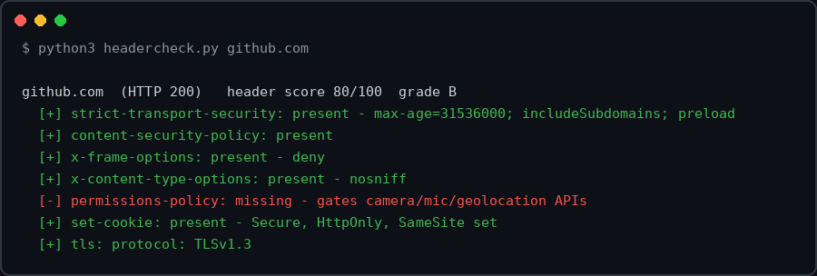

# headercheck

HTTP security-header and TLS certificate inspector for any host. Grades A-F and shows exactly which headers are missing and why each one matters.

Original code, stdlib only. The header set is the same one securityheaders.com checks; the grading and code are mine.

## Use

```sh
python3 headercheck.py example.com
python3 headercheck.py example.com --json
```

Checks: HSTS, Content-Security-Policy, X-Frame-Options, X-Content-Type-Options, Referrer-Policy, Permissions-Policy, Cross-Origin-Opener/Resource-Policy, cookie flags (Secure, HttpOnly, SameSite), TLS protocol version, certificate expiry.

## Tests

```sh
python3 -m unittest discover -s tests -v
```

## Sample output (real run)

```
$ python3 headercheck.py github.com

github.com  (HTTP 200)   header score 80/100  grade B
  [+] strict-transport-security: present - max-age=31536000; includeSubdomains; preload
  [+] content-security-policy: present
  [+] x-frame-options: present - deny
  [-] permissions-policy: missing - gates camera/mic/geolocation APIs
  [+] set-cookie: present - Secure, HttpOnly, SameSite set
  [+] tls: protocol: TLSv1.3
```


